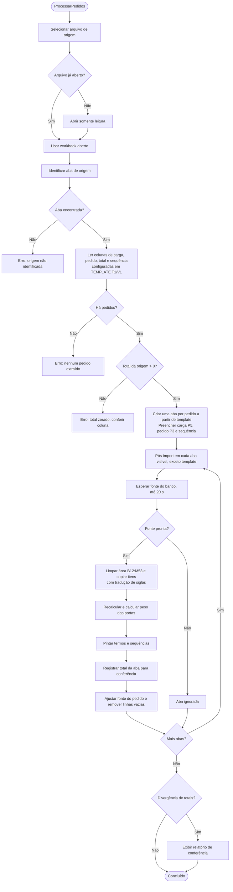

# Romaneio Automático (VBA)

Macros em VBA que geram os romaneios de carga a partir de um arquivo de pedidos. Para cada pedido, cria uma aba a partir do modelo `template`, preenche carga, pedido e itens vindos do banco, pinta palavras-chave, calcula o peso das portas e confere os totais contra a origem.

## Módulos

| Módulo | Função |
|---|---|
| `modRomaneio.bas` | Ponto de entrada (`ProcessarPedidos`). Lê o arquivo de origem, extrai pedidos e cria uma aba por pedido |
| `modPosImport.bas` | Pós-processamento de cada aba: substituição, pintura, peso, conferência e limpeza |
| `modLucasBD.bas` | Copia itens da fonte para o romaneio e traduz siglas (acabamentos, larguras, espessuras) |
| `modEsperaBanco.bas` | Aguarda a fonte de dados (QueryTables/ListObjects) ficar pronta, com timeout de 20 s |
| `modColorirItens.bas` | Pinta termos e sequências nos itens |
| `modPesoPortas.bas` | Calcula o peso das portas por tipo (Doorblanks, Colmeia, Lisa) e tamanho |
| `modSequencia.bas` | Escreve a sequência e a cor correspondente em cada aba |
| `modConferenciaTotais.bas` | Compara o total da origem com o total da aba e monta o relatório de divergências |
| `modConversao.bas` | Conversão segura de números, textos e sequências |
| `modAjusteFonte.bas` | Reduz a fonte da célula do pedido até caber |
| `modAppState.bas` | Modo rápido: desliga atualização de tela e cálculo, com contador de profundidade |
| `modTestes.bas` | Testes manuais (`ExecutarTestes`) das conversões, substituições e cálculos |

## Fluxo de execução

## Pré-requisitos

- Excel for Windows com macros habilitadas.
- Planilha modelo com aba `template` e as células de parâmetros:
  - `P3`: número do pedido
  - `P5`: número da carga
  - `TEMPLATE!T1`: coluna da sequência na origem (`0` desativa)
  - `TEMPLATE!V1`: coluna do total na origem (`0` desativa a validação de total)
- Fonte de dados do ERP configurada na aba de destino (conexão ODBC/Query). A conexão **não** fica no código; veja a seção de segurança.

## Instalação

1. Abra o arquivo modelo `.xlsb` ou `.xlsm`.
2. Alt+F11 → Arquivo → Importar arquivo, e selecione os `.bas` de `macros/`.
3. Salve o arquivo como `.xlsm`.

## Segurança

- Não versione o `.xlsb`: ele contém a string de conexão com o ERP, o nome do usuário do banco e dados de clientes.
- Não coloque usuário, senha ou caminhos de rede nos `.bas`. Use um arquivo de configuração local (`config.local.*`, já ignorado pelo `.gitignore`) ou configure a conexão só no Excel.
- Mantenha o repositório privado enquanto houver referências à estrutura do banco.

## Observações técnicas

- `modLucasBD.Substituir` apaga e reescreve `B12:M53`. Não rode sobre aba que tenha dados digitados manualmente.
- `POS_EXCLUIR_LINHA_INTEIRA = True` em `modPosImport` exclui linhas inteiras. Reexecutar pode deslocar as linhas da fonte `W11:W56`.
- `modEsperaBanco` aguarda até 20 s. Se o banco estiver lento, a aba é ignorada, e o aviso aparece no log do Debug, não em caixa de mensagem.
- `modTestes.ExecutarTestes` deve ser rodado após qualquer mudança em conversão, substituição ou peso.
